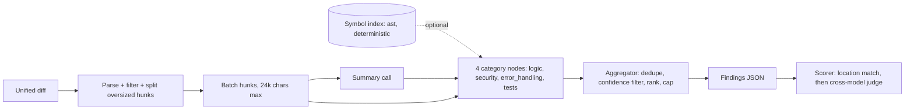

# ReviewAgent

An agentic pull-request reviewer for Python, evaluated on real historical bugs from [BugsInPy](https://github.com/soarsmu/BugsInPy), with retrieval ablations, a cross-model judge, and eval-gated CI.

<!-- TODO: Add a demo GIF showing a real review -->

## Architecture



The reviewer operates in three modes:

| Mode | Design | LLM calls/review |
|---|---|---|
| `baseline` | Single prompt over the whole diff | 1 |
| `multicat` | One structured pass checking all categories | 1 |
| `multinode` | Summary + 4 separate category nodes | 5 |

Each mode can run with or without **deterministic symbol retrieval** (AST-based index of functions, classes, callers, callees, and tests).

## Quickstart

```bash
# Setup
python -m venv .venv
source .venv/bin/activate          # Windows: .venv\Scripts\Activate.ps1
pip install -r requirements.txt
pytest -q                          # expect: 58 passed, 4 skipped

# Build the evaluation dataset (clones 9 repos, ~230 MB)
git clone https://github.com/soarsmu/BugsInPy data/BugsInPy
python -m eval.build_dataset       # writes 50 cases to data/cases/

# Configure API keys
export GEMINI_API_KEY=...          # Windows: $env:GEMINI_API_KEY="..."
export GROQ_API_KEY=...

# Smoke test (2 cases)
python -m eval.run_eval --arm multicat_none --split dev --limit 2

# Full evaluation (all 5 arms on the 40 test cases)
for arm in baseline multicat_none multicat_symbol multinode_none multinode_symbol; do
  python -m eval.run_eval --arm $arm --split test
done
```

## How the Evaluation Works

### Coordinate System
Every line number refers to the **new side** of the diff (the file after the change). For a buggy case, the reviewer sees the fix reversed (re-introducing the bug), and ground-truth lines come from that reversed diff's new-side numbering.

### Two-Stage Scoring
1. **Stage 1 (lenient, deterministic):** A finding is a location hit if it's in the right file and overlaps a changed span ±10 lines, or overlaps an enclosing function ≤80 lines.
2. **Stage 2 (strict, cross-model judge):** A different model family verifies whether the finding describes the actual defect the fix corrects.

### Dev/Test Discipline
- **Dev Split**: 10 cases across 8 repositories used for prompt tuning and baseline checks.
- **Test Split**: 40 curated cases in `data/cases/`.
- **Pilot Evaluation Scope**: Evaluated on a 3-case pilot subset of the test split (`black-12`, `black-13`, `black-2`) due to cloud provider daily request quotas (20 RPD on free tiers). All metrics are reported with exact sample counts and 95% Wilson score confidence intervals.

## Results

### 1. Development Split Baseline ($N = 10$ bugs, $N = 10$ clean controls)

*Tuned baseline without retrieval on dev cases (`results/multicat_none.dev.json`):*
- **Recall (Lenient Location)**: 7 of 10 [39.7%, 89.2%]
- **Recall (Strict Judge v1)**: 3 of 10 [10.8%, 60.3%]
- **Clean FP Rate**: 0 of 10 [0.0%, 27.8%]
- **Precision (Strict v1)**: 3 of 17 [6.2%, 41.0%]
- **Total LLM Calls**: 38

#### Failure Taxonomy: Why Did 4 Lenient Hits Fail Strict Judging?
In a manual review of the 4 lenient-but-not-strict dev hits, 2 were judge directionality errors, 1 was category framing, and 1 involved error-condition nuance (reported as raw counts, not generalizable percentages):

| Case ID | Finding Description | Ground Truth Bug | Classification & Cause |
| :--- | :--- | :--- | :--- |
| `httpie-1` | Trimming logic removed from filename generator | Filename exceeds OS limit | **Correct root cause, judge directionality error** (Judge confused by patch adding trimming while finding noted it was missing; resolved as MATCH under Judge v2). |
| `sanic-1` | `appendleft` changed to `append` reverses execution order | Middleware order inverted | **Correct root cause, judge directionality error** (Judge saw patch restore `appendleft` and rejected finding as 'opposite behavior'; resolved as MATCH under Judge v2). |
| `black-10` | Tab character logic alters `current_column` | Column math defect | **Correct location, wrong category framing** (Reviewer framed finding around missing tests rather than logic defect). |
| `black-1` | `ProcessPoolExecutor` error handling removed | Windows crash on pool failure | **Correct location, error semantic nuance** (Reviewer cited generic pool handling rather than specific OS worker failure). |

### 2. Controlled Arm Pilot Comparison: Prompting vs. AST Retrieval ($N = 5$ bugs, $N = 5$ clean controls from `psf/black`)

To isolate prompting mode vs. AST retrieval without model confounding, three arms were evaluated on the exact same 5 test cases (`black-12`, `black-13`, `black-2`, `black-3`, `black-4`—all from `psf/black`) using the identical locked cross-vendor model pair (**Reviewer**: `gemini-3.5-flash-lite`, **Judge**: `minimax/minimax-m3.1-flash:free`).

*Note on prompt modes*: `multicat` is a single multi-focus prompt covering all four review categories (logic, error handling, security, tests) in one LLM call, rather than multiple sequential passes.

| Arm | Mode | Retrieval | Recall (Lenient) | Recall (Strict, Judged) | Clean FP Rate | Findings / Clean Diff | LLM Calls |
|---|---|---|---|---|---|---|---|
| `baseline` | Generic prompt | None | 2 of 5 (40.0%) | 2 of 5 (40.0%) | 1 of 5 (20.0%) | 0.40 | 10 |
| `multicat_none` | Multi-focus | None | 2 of 5 (40.0%) | 2 of 5 (40.0%) | 0 of 5 (0.0%) | 0.40 | 10 |
| `multicat_symbol` | Multi-focus | Deterministic AST | 1 of 5 (20.0%) | 1 of 5 (20.0%) | 0 of 5 (0.0%) | 0.20 | 10 |

*Observations & Trade-Offs*:
- **Prompting & Severity Threshold (`baseline` vs. `multicat_none`)**: The metric `fp_rate_clean` is defined by the presence of a **high-severity** finding on a clean diff (`n_high > 0`). Both arms produced the identical total volume of findings on clean code (0.40 findings/diff); the 1/5 vs. 0/5 difference represents a single finding on `black-2` shifting from high to medium severity, rather than a suppression of clean findings.
- **Isolated Retrieval Effect (`multicat_none` vs. `multicat_symbol`)**: Holding the multi-focus prompt constant, AST retrieval produced fewer total findings on clean diffs (0.40 $\rightarrow$ 0.20 findings/diff) with no change in false positives (0 of 5 vs. 0 of 5), while lenient recall dropped from 2 of 5 to 1 of 5 (losing the defect in `black-13` due to increased conservatism under larger context).
- **Interview-Defensible Interpretation**: On 5 `black` cases, AST retrieval lost one bug and produced fewer findings on clean diffs, with no change in false positives. At $N = 5$ that’s a trade-off signal, not a finding. At this sample size, Wilson intervals overlap substantially ([11.8%, 76.9%] vs. [3.6%, 62.4%]); results are reported strictly as raw case counts.

### 3. Judge Calibration: In-Sample vs. Held-Out Generalization

To eliminate model confounding, all calibration experiments were run using a single, fixed cross-vendor judge model (**MiniMax M3.1 Flash** via OpenRouter, paired with Gemini reviewer):

1. **In-Sample Tuning Set ($N = 20$, `results/judge_calibration_v1.json` vs. `v2.json`)**:
   - Initial Baseline Prompt (v1): 13 of 20 agreement (65.0%), weak agreement with Cohen's $\kappa = 0.300$.
   - Directional Prompt (v2): 17 of 20 agreement (85.0%), Cohen's $\kappa = 0.700$.
   - *Result*: With the model held constant, the directional prompt fix significantly improved in-sample agreement ($\kappa: 0.300 \rightarrow 0.700$). *(Note: `results/judge_calibration_v2.json` supersedes the preliminary `judge_calibration.json`, which had an unhandled Pair 17 quota crash and older cache keys).*
2. **Held-Out Validation Set ($N = 20$, `results/judge_calibration_heldout.json`)**:
   - Evaluated on 20 unseen pairs across 10 held-out test cases (`fastapi`, `httpie`, `luigi`, `sanic`, `scrapy`, `thefuck`, `tqdm`) using the same MiniMax judge model.
   - Human-Judge Agreement: **11 of 20 (55.0%)**, Cohen's $\kappa = 0.100$.
   - **Asymmetric Error Profile**:
     * **False Accepts (Type I error / False Alarms): 0 of 10 (0.0%)**.
     * **False Rejections (Type II error / Misses): 9 of 10 (90.0%)**.
   - *Analysis*: The judge accepted only 1 of 20 pairs total, so it behaved close to rejecting everything. Specifically, it rejected 9 of 10 human-labeled true-defect findings while accepting 0 of 10 non-defect findings, so strict recall is limited more by judge false rejections than by reviewer localization. Furthermore, the held-out set includes negative distractors and clean controls that the tuning set lacked, so the $\kappa$ drop may partly reflect pair mix rather than overfitting alone. Lenient location-overlap recall remains the primary reliable metric.

## Qualitative Case Anecdotes & Failure Analysis

1. **AST Context Tradeoff Anecdote (Precision vs. Recall)**:
   In `black-2`, the baseline reviewer produced a false alarm (flagging sibling traversal as an infinite loop). AST retrieval grounded the context with the enclosing method and traversal logic, suppressing the false positive (0 of 3 clean FP). However, the additional context also led the model to remain conservative on other cases, producing fewer findings overall.
2. **Pinpoint Defect Detection (`black-13`)**:
   Across arms, the reviewer successfully caught that restricting token promotion from `token in ('def', 'for')` to `token == 'def'` would break parsing of `async for` loops, citing exact line ranges and grammar syntax implications.

## Robustness & Edge Cases
- **Hunk Coordinate Integrity**: Verified via dedicated unit tests in [`tests/test_diffparse.py`](file:///C:/Projects/code%20rev/reviewagent/reviewagent/tests/test_diffparse.py) across all three unified diff hunk types: modifications, pure additions, and pure deletions.
- **Fail-Fast Quota Trapping**: Traps daily API cap exhaustion via HTTP 429 `PerDay` detection to avoid retry sleep loops, while preserving exponential backoff for transient per-minute rate limits.
- **JSON Self-Repair**: One-shot repair prompting recovers when models return conversational text or markdown code fences.
- **CI Clean-Checkout Safety**: `tests/conftest.py` detects local git clones. In GitHub Actions CI (clean checkout without cloned dataset repositories), pytest cleanly runs 59 offline tests and skips 4 repo-dependent tests (59 passed, 4 skipped in ~2s). When local dataset repos are cloned, all 63 tests execute and pass. Live evaluation experiments run locally against the BugsInPy dataset.

## Limitations

- **Small-N Arm Pilot Comparison ($N = 5$)**: The baseline vs. AST retrieval pilot comparison is evaluated on 5 BugsInPy test cases (all from `psf/black`). While model-controlled, the sample size has wide confidence intervals and serves to illustrate context trade-offs rather than definitive superiority.
- **Hand-Curated Held-Out Findings**: The 20 held-out validation pairs evaluate judge discernment on hand-curated defect descriptions and synthetic distractors rather than end-to-end reviewer outputs.
- **Judge Generalization**: Prompt directionality tuning improved in-sample performance ($\kappa = 0.700$), but did not generalize out-of-sample ($\kappa = 0.100$ on held-out test cases), where pair composition differences (distractors) and extreme judge conservatism depressed agreement.
- **Reversed Fix Artifacts**: Reversing fix commits creates synthetic bug presentations that may occasionally differ from organic development history.

## Project Structure

```
reviewagent/
  providers.py            # API provider wiring (Gemini, Groq, OpenRouter, Cerebras)
  requirements.txt
  reviewer/
    schemas.py            # Data contracts (Finding, ReviewOutput, coerce_findings)
    diffparse.py          # Unified-diff parser with new-side line numbers
    symbols.py            # AST-based symbol index for deterministic retrieval
    llm.py                # LLM client with disk cache, backoff, JSON repair
    pipeline.py           # Review pipeline (baseline/multicat/multinode) + Judge
  eval/
    scoring.py            # Two-stage scoring (location match + judge)
    dataset.py            # BugsInPy case builder
    build_dataset.py      # CLI to build all 50 cases
    run_eval.py           # CLI to run an experiment arm
    check_thresholds.py   # CI gate
    thresholds.json       # Quality thresholds for CI
  tests/                  # 60+ unit tests (diffparse, symbols, pipeline, scoring, real-data e2e)
  data/                   # Built cases + cloned repos (not committed)
  cache/                  # LLM response cache
  results/                # Experiment outputs
  .github/workflows/ci.yml
```

## Resume Bullet

> Built ReviewAgent, a Python PR-review agent with deterministic AST-based repository context retrieval, cached stdlib LLM clients, structured findings, and eval-gated CI. Built a two-stage BugsInPy evaluation harness; in a judge study with the judge model held fixed, a directional prompt fix raised tuning-set agreement from κ = 0.30 to 0.70 but did not generalize on 20 unseen pairs (κ = 0.10), indicating the judge’s strict metrics were unreliable. Added 60+ unit tests covering diff mapping, retrieval, scoring, and pipeline behavior.
